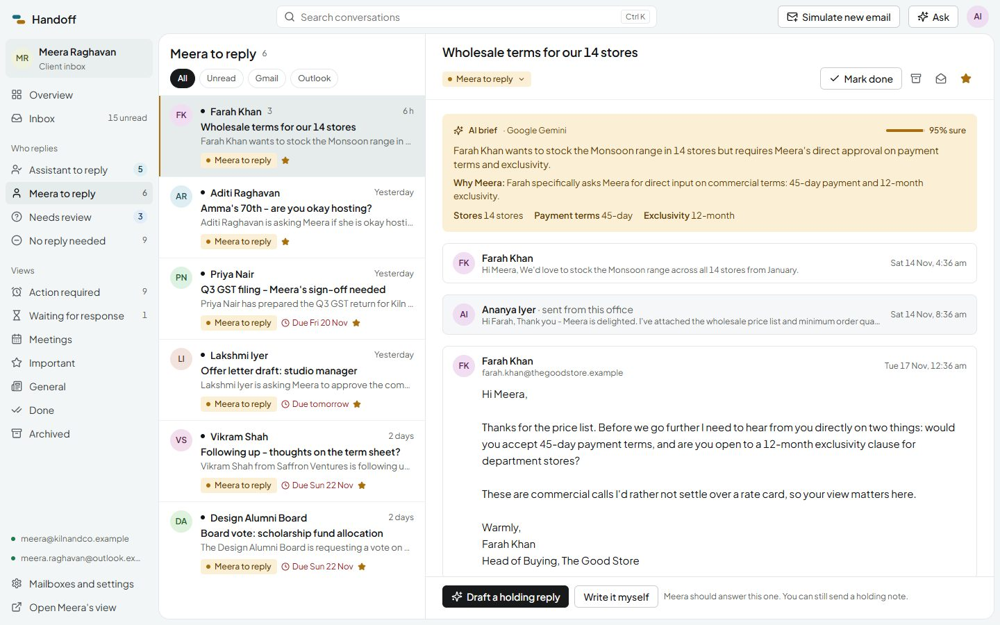
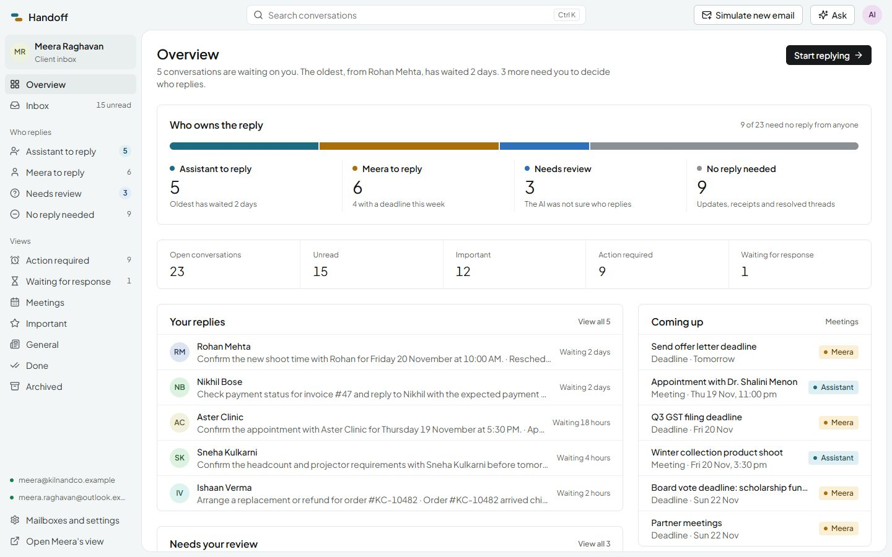
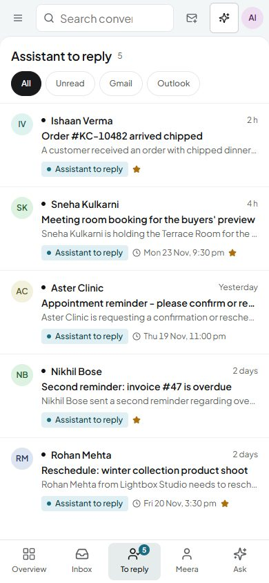
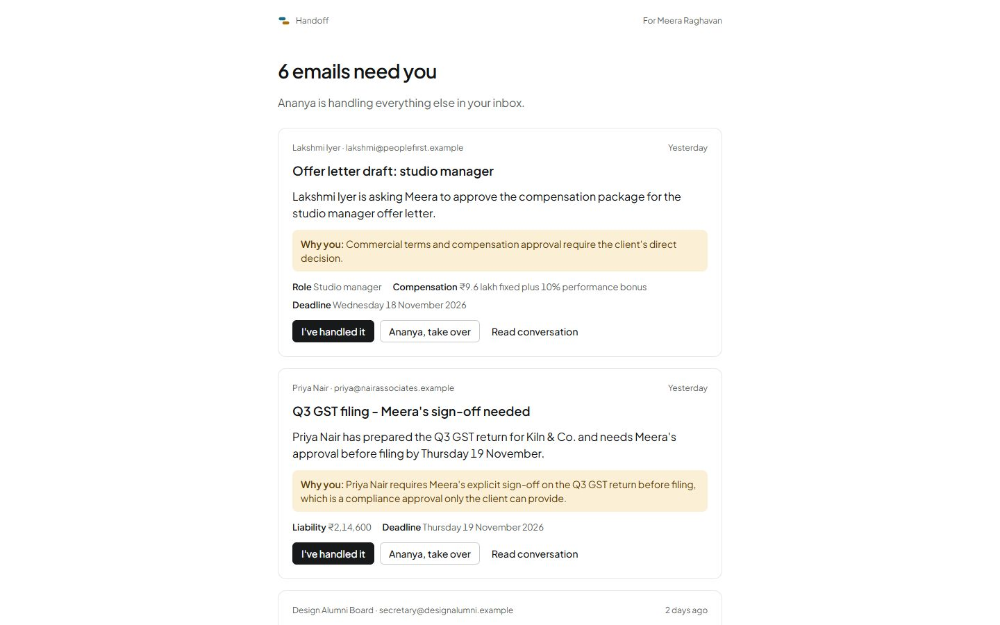
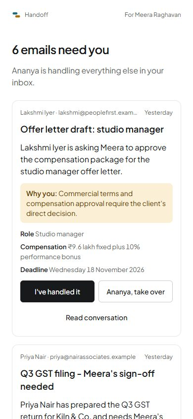
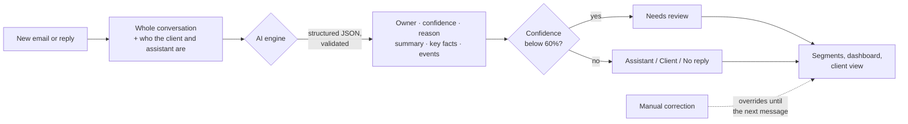
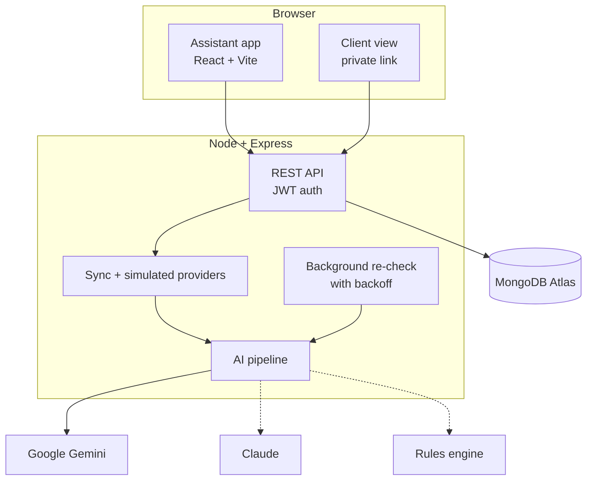

<div align="center">


# Handoff

**AI email triage for personal assistants and the clients they work for.**

Handoff reads a client's inbox and decides, for every conversation, who owes the reply:
the assistant, the client, or nobody.

[**Open the live demo**](https://handoff-oumq.onrender.com) · [How the AI decides](#how-the-ai-decides) · [Run it locally](#run-it-locally)




</div>

---

## The problem

A personal assistant handles a client's inbox, but most of the effort isn't reading email. It's working out **whose move it is**. A client reads a message and says nothing: do they plan to answer it, or do they expect the assistant to? Approvals sit unanswered, routine requests wait on the client for no reason, and the assistant ends up reading every email twice.

## What Handoff does

| | |
|---|---|
| **Sorts every conversation by who replies** | *Assistant to reply*, *Client to reply*, *No reply needed*, or *Needs review* when the AI isn't sure. Each decision comes with a plain-language reason and a confidence score. |
| **Reads the whole conversation** | A later message can withdraw a request or settle a decision. When a new email lands in a thread, the AI decides again and logs the change. |
| **Keeps the assistant in control** | Any decision can be corrected in one click. Replies are drafted by the AI but never sent without review. |
| **Gives the client a page of their own** | A private link shows only the emails that need the client, why, and two actions: *I've handled it* or *hand it to my assistant*. No login, no dashboard. |
| **Doesn't invent work** | Newsletters, receipts, resolved threads and conversations where we spoke last are marked *No reply needed*. In the demo, 9 of 23 conversations need no reply from anyone. |

## Try it

Open **[handoff-oumq.onrender.com](https://handoff-oumq.onrender.com)** and choose **Explore the demo workspace**. Each visitor gets a private workspace with two connected mailboxes and 23 realistic conversations.

> The site is on Render's free plan, which sleeps when idle: the first visit can take up to a minute to load. On a fresh workspace, Gemini's analysis replaces the instant first-pass sort within a few minutes.

A five-minute tour:

1. **Overview.** The bar under *Who owns the reply* shows the whole inbox split by owner. Click **Start replying**.
2. **A conversation.** Read the AI brief: summary, reason, confidence and key facts. Click **Draft reply with AI**, try *Shorter* or *More formal*, then **Approve and send**.
3. **Needs review.** See an email where the AI was unsure and why. Use the owner tag to assign it yourself.
4. **Simulate new email** (top bar). A reply arrives in a conversation you were waiting on, and the AI moves it back to *Assistant to reply*.
5. **Ask** (top bar, or <kbd>Ctrl</kbd> <kbd>J</kbd>). Try *"What am I waiting for a response on?"* or *"Why has this email been assigned to the client?"*
6. **Open Meera's view** (bottom of the sidebar). Hand one email back to the assistant with a note, then return: it's in your queue and in *Activity*.

Keyboard: <kbd>↑</kbd> <kbd>↓</kbd> or <kbd>J</kbd> <kbd>K</kbd> move through the list, <kbd>E</kbd> marks done, <kbd>Esc</kbd> closes, <kbd>Ctrl</kbd> <kbd>K</kbd> searches.

## Screens

<table>
  <tr>
    <td width="62%"></td>
    <td></td>
  </tr>
  <tr>
    <td><b>Overview.</b> The inbox at a glance: who owns each reply, what's waiting, and meetings and deadlines pulled out of email.</td>
    <td><b>Phone.</b> One region at a time, with a bottom bar for the places used most.</td>
  </tr>
  <tr>
    <td></td>
    <td></td>
  </tr>
  <tr>
    <td colspan="2"><b>The client's view.</b> Only what needs them, the reason, the key facts, and two ways out. Anything they do appears on the assistant's side within seconds.</td>
  </tr>
</table>

## How the AI decides

Every conversation passes through one pipeline when it arrives, and again whenever a new message lands in it.



**What the AI returns for each conversation** (validated against a schema before it is used):

| Field | Used for |
|---|---|
| `responsibility` | The owner tag, the segments and the client view |
| `confidence` | Below 60%, the conversation goes to *Needs review* instead of guessing |
| `reason` | The *Why* line the assistant and the client see |
| `summary`, `keyFacts` | The AI brief: amounts, references, deadlines |
| `events` | *Coming up* on the dashboard and the *Meetings* segment |
| `actionRequired`, `important`, `expectsReply` | *Action required*, *Important* and *Waiting for response* |

**Three engines, one contract** (`server/ai/index.js`):

- **Google Gemini** (`GEMINI_API_KEY`): classification, summaries, reply drafts and questions about the inbox. Runs on the free tier: requests are spaced out and small, busy models are rested and others tried, and quota errors are never retried in a loop.
- **Claude** (`ANTHROPIC_API_KEY`): the same contract through the Anthropic SDK, with structured outputs and a cached system prompt.
- **Rules engine** (`server/ai/heuristic.js`): weighted cues in the email text, used when no key is set and as the instant fallback. When a model is busy, the rules engine answers so nothing stalls, and a background job re-runs those conversations through the model with exponential backoff. The AI brief always shows which engine produced it.

Guardrails that apply to every engine:

- Email content is treated as data. Instructions inside an email are never followed.
- A manual correction by the assistant or the client stays until a new message arrives.
- Replies are drafted, never sent automatically. A conversation that needs the client gets a holding reply, not a decision made on their behalf.

## Feature checklist

| Brief | In Handoff |
|---|---|
| Onboarding and email connection | Sign up or log in, connect Gmail and Outlook, watch the inbox get sorted with live progress, then share the client's link |
| Assistant dashboard | Owner breakdown, open, unread, important, action required, waiting; your replies, needs review, the client's queue, recent conversations, meetings and deadlines, activity |
| Reply responsibility | Automatic on arrival and on every new message, history-aware, shown in the list, manually changeable, *Needs review* below 60% confidence |
| Client-facing view | Sender, subject, date, AI summary, why the client is needed, the full conversation, *handled* or *hand over with a note*, synced both ways |
| Segments | Assistant to reply, Client to reply, Needs review, No reply needed, Action required, Waiting for response, Meetings, Important, General, Done, Archived |
| Conversation management | Read the thread, mark important or unread, archive, mark done, undo, search, filter by mailbox |
| AI assistance | Summaries, key facts, dates and deadlines, reply drafts in four tones, questions about the inbox |
| States and responsiveness | Loading skeletons at final size, empty states that say what goes there, errors inside the failed block with *Retry*, success toasts with *Undo*, layouts for desktop, tablet and phone |

## What is simulated

This is a prototype. Everything below is real except where this table says otherwise.

| Area | In this prototype | In production |
|---|---|---|
| Gmail / Outlook connection | A consent screen, then a realistic sample mailbox | Google OAuth and the Gmail API, Microsoft Graph. `server/services/sync.js` is the seam. |
| Incoming email | The **Simulate new email** button delivers five scripted arrivals | Provider push notifications or polling |
| Sending | The reply is stored and the conversation reclassified; nothing leaves the app | Send through the provider API |
| Client access | An unguessable private link | The same link behind a one-time code or SSO |

The sample mailbox (`server/data/mailbox.js`) is **not pre-labelled**. Every email goes through the same AI pipeline live mail would, and dates are generated relative to today so the demo never goes stale. People, companies and email addresses in it are invented.

## Architecture



- **One server** hosts the API and the built React app.
- **One source of truth** (`server/services/inbox.js`) computes each thread's owner, waiting state and segments, so the dashboard, inbox, client view and AI answers never disagree.
- **Storage** is MongoDB through Mongoose, or an in-memory store with the same interface when `MONGODB_URI` is not set.
- **The client polls** every few seconds, so a client's action appears on the assistant's screen without a refresh.

## Run it locally

Requires Node.js 20 or later.

```bash
git clone https://github.com/ghosttech07/Ai-Email-Manager.git
cd Ai-Email-Manager
npm install
npm run build
npm start
```

Open http://localhost:4000. With no configuration at all, data is kept in memory and the rules engine does the AI work. To change that, copy `.env.example` to `.env`:

| Variable | Effect |
|---|---|
| `GEMINI_API_KEY` | Use Google Gemini. A free key comes from [aistudio.google.com/apikey](https://aistudio.google.com/apikey). |
| `GEMINI_MODEL` | Preferred Gemini model. Default `gemini-3.5-flash-lite`; others are tried automatically when it is busy. |
| `ANTHROPIC_API_KEY`, `AI_MODEL` | Use Claude instead (default model `claude-opus-5-5`). `AI_PROVIDER=gemini` or `claude` picks one when both keys are set. |
| `MONGODB_URI` | Store data in MongoDB. Without it, data resets when the server restarts. |
| `JWT_SECRET` | Signs login tokens. Without it, everyone is logged out on restart. |
| `CLIENT_TIMEZONE` | Time zone that times written in emails are read in. Default `Asia/Kolkata`. |

Development with hot reload: `npm run dev` (API on port 4000, Vite on 5173). Tests: `npm test`.

## Deploy

The repository includes a Render blueprint (`render.yaml`).

1. On Render: **New → Blueprint**, then choose this repository.
2. Enter `MONGODB_URI` and `GEMINI_API_KEY` when asked. `JWT_SECRET` is generated for you.
3. In MongoDB Atlas, under **Network Access**, allow `0.0.0.0/0`: Render's free servers have no fixed address.

Every push to `main` redeploys. Any other Node host works with `npm install && npm run build` to build and `npm start` to run.

## API

All routes are under `/api`. Everything except auth, the client view and health needs a `Bearer` token.

| Method | Route | Purpose |
|---|---|---|
| `POST` | `/auth/register`, `/auth/login`, `/auth/demo` | Create an account, log in, or open a private demo workspace |
| `GET` / `PATCH` | `/me` | The signed-in user, the AI engine and storage in use |
| `POST` / `DELETE` | `/accounts`, `/accounts/:id` | Connect or disconnect a mailbox |
| `POST` | `/accounts/:id/sync` | Sync a mailbox again |
| `GET` | `/inbox` | Conversations with owner and segments, mailboxes, activity |
| `PATCH` | `/threads/:id` | Read, important, archived, done, or a new owner |
| `POST` | `/threads/:id/reclassify` | Ask the AI to decide again |
| `POST` | `/threads/:id/draft` | AI reply draft, optionally with a tone |
| `POST` | `/threads/:id/reply` | Send an approved reply (simulated) |
| `POST` | `/ai/ask` | A question about the inbox |
| `POST` | `/simulate/incoming` | Deliver the next scripted email |
| `GET` / `POST` | `/client/:token`, `/client/:token/threads/:id` | The client's view and their actions |
| `GET` | `/health` | Status, storage and AI engine |

## Project structure

```
server/
  index.js              Express app; serves the built client in production
  routes.js             Auth, mailboxes, inbox, AI, client view
  store.js              MongoDB (Mongoose) or in-memory, behind one interface
  config.js             Environment settings and the client's time zone
  ai/
    index.js            Gemini, Claude and fallback behind one contract
    heuristic.js        Rules engine: classification, extraction, drafts, Q&A
    heuristic.test.js   28 tests over every sample conversation
  services/
    inbox.js            Owner, waiting state and segments: the single source of truth
    sync.js             Simulated providers, background re-check, incoming email, sending
  data/mailbox.js       Sample conversations
client/src/
  state.jsx             Session, inbox (polled), toasts
  components/           Shell, Ask panel, connect dialog, shared UI
  pages/                Welcome, Onboarding, Overview, Inbox, Settings, ClientView
  styles.css            Design tokens and components
render.yaml             Render blueprint
```

## Design decisions

- **Colour has one job.** Teal means the assistant replies, amber the client, blue *needs review*, grey nobody. The rest of the interface is neutral, so the owner of every conversation reads at a glance.
- **Two experiences for two people.** The assistant gets the full workspace; the client gets one page with no navigation, because their only question is *what needs me?*
- **The AI shows its work.** Every decision has a reason and a confidence, and the brief says which engine wrote it. When unsure, it asks instead of guessing.
- **Mistakes are cheap.** Done, archive, *Archive all* and the client's actions can all be undone, and destructive steps such as disconnecting a mailbox ask first.
- **Every state is designed.** Loading keeps the final layout, errors stay inside the block that failed, and empty segments say what would appear there.

## What's next

- Real Gmail and Microsoft 365 connections through OAuth, with the sample mailbox kept for demos
- *Action required* emails turned into tasks, and meetings found in email offered as calendar holds
- Approvals recorded from the client's view that trigger the reply automatically
- Custom addresses on the platform's own domain, so a client can route mail straight into Handoff

---

<div align="center">
Built with React, Node, Express, MongoDB and Google Gemini.
</div>
